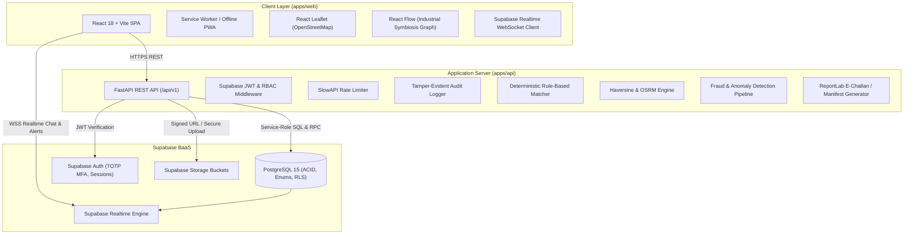

# System Architecture: Waste Exchange Platform

## 1. System Overview
Waste Exchange Platform is a secure, cloud-native B2B marketplace engineered for **Industrial Symbiosis**. It enables manufacturing and production facilities to directly monetize or transfer industrial byproducts to complementary industries where those byproducts serve as secondary raw materials.

---

## 2. Component Design

### 2.1 Frontend (`apps/web`)
- **Framework:** React 18 with TypeScript and Vite.
- **Styling & Components:** Tailwind CSS, shadcn/ui design patterns, Lucide icons.
- **Routing:** React Router v6 with centralized `AuthGuard` and `RoleGuard` wrappers.
- **State & Caching:** TanStack Query (React Query) for optimistic updates and caching.
- **Visualizations:**
  - **Recharts:** Monthly waste volume, ESG $\text{CO}_2$ mitigation, and cost-saving metrics.
  - **React Leaflet:** Interactive geospatial map showing proximity of candidate industries and active listings.
  - **React Flow:** Visual interactive DAG representing industrial symbiosis flows (e.g. Sugar Mill $\rightarrow$ Bagasse $\rightarrow$ Paper Mill).
- **Internationalization (i18n):** `i18next` supporting seamless toggle between English and Tamil (தமிழ்).

### 2.2 Backend (`apps/api`)
- **Framework:** FastAPI (Python 3.11+).
- **Security & Middleware:**
  - JWT verification against Supabase Auth public keys.
  - Role-Based Access Control (`require_role`, `require_approved_industry`).
  - Strict CORS origin whitelisting and security headers (HSTS, CSP, X-Frame-Options).
- **Domain Services:**
  - `matching.py`: Evaluates waste-type compatibility, haulage distance, quantity fit, hazardous clearance, and trust score.
  - `geo.py`: Calculates Haversine distance and OSRM routing metrics.
  - `carbon.py`: Computes verifiable Scope 3 $\text{CO}_2$ mitigation and landfill diversion.
  - `manifest.py`: Generates cryptographic, QR-coded PDF manifests / e-challans.
  - `fraud.py`: Anomaly engine detecting duplicated GST numbers, reused document hashes, price outliers, and listing spam.

### 2.3 Database & Storage (`supabase/`)
- **Relational PostgreSQL:** 25 normalized tables with Foreign Key integrity, custom ENUM domain types, and GIST geospatial indexes.
- **Row Level Security (RLS):** Enforced on 100% of tables to ensure total tenant isolation.
- **Storage Buckets:**
  - `industry-docs` (Private, AES-encrypted, signed URL access only).
  - `listing-media` (Public images, private lab tests).
  - `manifests` (Private e-challans).
  - `qr-codes` (Public read batch QR codes).
